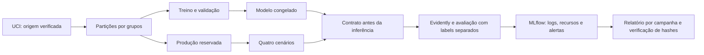

# Monitoramento de Risco de Crédito

Camada de confiabilidade para um classificador de crédito, com contratos de dados,
detecção de drift, observabilidade de pipelines e documentação de governança.

Projeto acadêmico da Fase 4 de Machine Learning Engineering da FIAP.

## Estado

Pipeline batch implementado com Pandera, HistGradientBoosting, Evidently e MLflow.
O percurso Docker prepara dados, congela o baseline, executa quatro cenários e
verifica relatórios por campanha explícita. Resultados agregados e proveniência
estão em [evidências](docs/evidencias/README.md). Vídeo e validação manual em outro
computador permanecem pendentes; não há submissão declarada.



## Percurso completo de avaliação

Requisitos: Git, GNU Make, Docker com Compose, acesso ao daemon, internet para
imagens/dependências/UCI, filesystem POSIX gravável e porta local 5000 disponível.
Python e Poetry no host são opcionais. Execute na raiz do clone em Linux/WSL2.
O ambiente medido está em [ambiente](docs/ambiente.md); recursos variam por host.

```bash
make setup
make build
make docker-lint
make docker-test
make docker-data
make docker-inspect-data
make docker-train
make docker-evaluate
make docker-promote
make tracking-up
make status
make docker-demo
```

Copie o `campaign_id` da saída final e substitua `<campaign_id>`:

```bash
make docker-report CAMPAIGN_ID=<campaign_id>
make docker-verify-evidence CAMPAIGN_ID=<campaign_id>
make docker-governance
```

Esperado: baseline aprovado, 19 lotes de cenários, rejeição integral do inválido,
23 comparações e gates aprovados. `verify-evidence` deve informar `verified`.
Abra `artifacts/campaigns/<campaign_id>/index.html` e a UI
[MLflow local](http://127.0.0.1:5000), confira os IDs da campanha e encerre com
`make tracking-down`. Os detalhes abaixo explicam cada comando e as falhas esperadas.
Snapshots Evidently permanecem locais; apenas agregados revisados são versionados.
Para conferir o conteúdo publicável em checkout com Git e Python 3:
`make check-publication`. A inspeção de imagens e HTML exige revisão visual adicional.

## Rastreabilidade dos critérios

| Critério | Peso | Comando e evidência |
|---|---:|---|
| Validação de dados | 25% | `make docker-demo`; rejeição sem scores em `scenarios.json`, contratos em `src/data/contracts.py` |
| Detecção de drift | 25% | `make docker-demo`; `deteccao.json`, `scenarios.json`, HTML Evidently local e `docs/causalidade.md` |
| Observabilidade e logs | 20% | `make docker-report CAMPAIGN_ID=...`; `campaign.json`, imagens agregadas, MLflow e `docs/operacao.md` |
| Governança | 15% | `make docker-governance`; `governanca.json`, análise abaixo e `docs/governanca.md` |
| Vídeo STAR | 15% | Pendente de gravação, duração até cinco minutos e acesso externo verificado |

As evidências não substituem o vídeo nem a execução manual independente.

## Objetivos

- Validar entradas e bloquear lotes que violem contratos de qualidade.
- Comparar dados de referência com cenários simulados de produção.
- Identificar mudanças estatísticas e acompanhar a qualidade do modelo.
- Consolidar logs, métricas e alertas operacionais.
- Documentar privacidade, retenção e limitações do uso dos dados.

O projeto tem finalidade educacional e não é um serviço de decisão de crédito.

## Governança, privacidade e limites do score

O projeto reproduz, para fins acadêmicos, um classificador sobre o conjunto UCI
Default of Credit Card Clients, publicado por Yeh em 2009. A licença indicada pela
UCI é CC BY 4.0: a redistribuição exige atribuição, link para a licença e indicação
de alterações. Essa licença trata dos direitos concedidos sobre o material; por si
só não comprova consentimento dos titulares, anonimização ou autorização irrestrita
para qualquer tratamento. A base é histórica, de Taiwan, com valores em NT$.

O estudo não concede crédito nem produz decisões sobre pessoas. A hipótese de uma
fintech que avalia proteção do crédito é separada deste uso acadêmico. Em uma
operação real, o art. 7º, X, da LGPD prevê a hipótese de proteção do crédito; sua
aplicação depende do contexto e dos requisitos legais. O art. 20 disciplina a
solicitação de revisão de decisões tomadas unicamente com base em tratamento
automatizado que afetem os interesses do titular. O art. 7º, IV, refere-se a
estudos por órgão de pesquisa. Este projeto não declara que sua equipe se enquadra
nessa definição, que existe consentimento ou que qualquer hipótese legal foi
validada para a atividade. Não se declara conformidade jurídica certificada.

A preparação local mantém origem, `record_id`, rótulo e tabela de auditoria com SEX,
AGE, EDUCATION e MARRIAGE. O preditor recebe somente 19 variáveis financeiras;
demografia não é concatenada às features. A tabela de auditoria é associada por ID
somente depois de carregar as features, labels e previsões do teste. O ID e os
arquivos individuais ficam em `data/`, ignorados pelo Git. O diagnóstico por grupo
publica apenas contagens, denominadores, métricas agregadas e hashes em
`docs/evidencias/governanca.json`. Métricas com n<100 ou denominador relevante
inferior a 20 são suprimidas, sem completar grupos ausentes.

No teste original, todos os grupos observados excederam os pisos, com 4.500
registros e limiar 0,5. Os resultados são descritivos:

| Grupo | n | Prevalência | Recall | FPR | Brier |
|---|---:|---:|---:|---:|---:|
| AGE 21 a 34 | 2334 | 0,2112 | 0,3732 | 0,0549 | 0,134671 |
| AGE 35 a 49 | 1749 | 0,2196 | 0,3724 | 0,0498 | 0,134003 |
| AGE 50+ | 417 | 0,2830 | 0,3136 | 0,0602 | 0,174360 |
| SEX código 1 | 1800 | 0,2322 | 0,3995 | 0,0622 | 0,141794 |
| SEX código 2 | 2700 | 0,2137 | 0,3414 | 0,0476 | 0,135619 |

Modelo `3a1a313f639fbbf23388c90a0227bc9d29936aec574d27ca471cf52de7ed293c`,
SHA-256 do artefato `b2982bacacd984cbc942c600d39f44423e040500fed277a439ad6c97eb4e7838`,
manifesto de dados `18f2f7e2eed2a21134dc54541e62d14d17d08c34f69245616360ffc58eba0bbf`.
O SHA-256 da evidência é `a2e87c1b29fff1c8036ec5256d6f1a437fecf3010319f3172eeb7b0879a1b3db`.
Os denominadores por métrica e os hashes das entradas de auditoria estão no JSON.

O score é uma probabilidade estimada pelo baseline, não uma decisão, limite de
aprovação ou medida de justiça. A avaliação por SEX e faixas de AGE é descritiva
do teste retido e tem amostras menores após segmentação. Recall/FPR dependem do
limiar demonstrativo 0,5; diferenças entre grupos não identificam causa nem provam
discriminação. Remover atributos explícitos não elimina proxies. A mitigação prevista
é investigar coleta e representação, ampliar evidência, revisar variáveis e comparar
alternativas antes de qualquer mudança de limiar ou modelo.

A análise causal permanece limitada ao mecanismo sintético de `concept_drift`: para
os mesmos IDs, features, modelo e scores, o simulador sorteia U independentemente
por construção e aplica `Y(r)=Y(0) OR ((Y(0)=0) AND (U<r))`. A última janela
observada aumentou o Brier em 0,177789, com IC95% pareado [0,157599; 0,199006],
em 1.000 reamostragens. Isso mede o simulador, não o efeito de inflação, desemprego,
limite de crédito ou outra intervenção econômica. Importância por permutação mede
dependência preditiva do modelo e não é evidência causal.

Dados locais e artefatos operacionais permanecem no host. `make docker-retention`
apenas lista execuções de `artifacts/runs` com mais de 30 dias; a exclusão exige
`make docker-retention DELETE=1` e alcança somente diretórios diretos dessa área.
O comando não remove dados, modelos, evidências versionadas nem o banco/artefatos
do MLflow em `state/mlflow`. Após confirmação do arquivamento, a eliminação dos
dados de entrega continua manual. O prazo de 30 dias é uma política operacional
deste projeto, não prazo legal universal. Consulte [governança](docs/governanca.md),
[métricas por grupo](docs/metricas.md) e [operação](docs/operacao.md).

## Evidências da rubrica

| Critério | Peso | Evidência e estado |
|---|---:|---|
| Validação | 25% | [Contratos](docs/adr/0003-contratos-e-bloqueio.md) e [rejeição na campanha](docs/evidencias/campaign.json) |
| Drift | 25% | [Cenários pareados](docs/evidencias/scenarios.json) e [detecção](docs/evidencias/deteccao.json) |
| Observabilidade | 20% | [Campanha reproduzível](docs/evidencias/campaign.json) e [relato](docs/reproducibilidade.md) |
| Governança | 15% | [Diagnóstico agregado por grupos](docs/evidencias/governanca.json) e esta seção |
| Vídeo | 15% | Pendente de gravação e publicação na etapa de entrega |

Fontes consultadas: [Lei nº 13.709/2018, texto oficial consolidado](https://www.planalto.gov.br/ccivil_03/_ato2015-2018/2018/lei/l13709compilado.htm), [dataset na UCI](https://archive.ics.uci.edu/dataset/350/default%2Bof%2Bcredit%2Bcard%2Bclients) e [licença CC BY 4.0](https://creativecommons.org/licenses/by/4.0/).

## Requisitos de ambiente

Linux ou WSL2, Git, GNU Make, Docker Engine/Desktop com daemon acessível e Docker
Compose v2 ou posterior. O percurso Docker não exige Python nem Poetry no host.
É necessário acesso ao Docker Hub e ao PyPI no primeiro build e na geração do lock.

Confira o acesso antes de executar:

```bash
docker info
docker compose version
```

Se `docker info` falhar por permissão, confira a integração da distribuição WSL com
Docker Desktop e as permissões do usuário local para acessar o socket.
Não use `chmod 777` no socket ou nos volumes.

## Preparação e execução em Docker

Execute na raiz deste repositório:

```bash
make help
make setup
```

`setup` copia `.env.example` somente se `.env` estiver ausente e cria diretórios
locais de dados, modelos, artefatos e estado como o usuário do host, sem sudo.
Não substitui configurações ou arquivos existentes.

Com os diretórios preparados, execute:

```bash
make build
make docker-lint
make docker-test
docker run --rm monitoramento-risco-credito:runtime
```

Resultados esperados e verificados em 24/10/2026:

- `build`: imagens `monitoramento-risco-credito:dev` e `:runtime`, sem dados do host.
- `docker-lint`: Ruff sem erros de lint ou formatação.
- `docker-test`: todos os testes aprovados, incluindo HTML/JSON Evidently e gravação/
  recuperação de run e artefatos em SQLite pelo MLflow real, usando dados sintéticos.
- `runtime`: uma linha JSON com evento `foundation_ready` e seed 42.

Os testes usam diretórios temporários, sem dataset, treino anterior ou servidor de
tracking ativo. HTML/JSON, banco e artefatos de teste são descartáveis. Nenhum serviço
é iniciado em segundo plano e nenhuma porta é publicada nesta fundação.

`make lock` é um comando de manutenção: resolve dependências em container com
Python 3.12 e Poetry 2.5.1. Use somente ao atualizar deliberadamente dependências;
revise o lock gerado antes de versioná-lo. Build e CI não o regeneram.

## Desenvolvimento local opcional

Com Python 3.12 e Poetry 2.5.1 já disponíveis:

```bash
poetry check --lock
poetry sync --with dev
make lint
make test
```

O teste de ambiente confere a versão do Python e os pins das bibliotecas. Executá-lo
com outro ambiente não substitui a prova de compatibilidade do projeto.

## Configuração e estado local

Settings deriva os caminhos da raiz do projeto, independentemente do diretório
corrente. Argumentos explícitos prevalecem sobre ambiente, `.env` e defaults.
Chaves desconhecidas no `.env` são rejeitadas. A URI de tracking não aceita senha
embutida. `SEED` e `LOG_LEVEL` inválidos geram erro de validação.

O Make passa o UID/GID do host ao build e ao Compose. `data/`, `models/`, `artifacts/`
e `state/` ficam locais e ignorados pelo Git. `.env` também não é versionado.
Logs JSON aceitam campos operacionais definidos no código e descartam payloads,
credenciais e exceções completas. Mensagens de evento devem ser estáticas.

Detalhes e limites da validação em [ambiente](docs/ambiente.md).
Decisão de execução em [ADR 0001](docs/adr/0001-execucao-local.md).

## Aquisição e preparação dos dados

Após `make setup` e `make build`, execute:

```bash
make docker-data
make docker-inspect-data
```

`docker-data` baixa o ZIP oficial da UCI na primeira execução, com timeout de 60
segundos por operação de rede e limite de 20 MB. Verifica os hashes congelados do
ZIP e do XLS e cria `data/bronze/`, `data/silver/` e `data/gold/`. Nas reexecuções,
reutiliza o cache bruto verificado. `docker-inspect-data` verifica os hashes de
todos os arquivos gerados e apresenta somente estatísticas agregadas.

Resultado esperado: 30.000 registros utilizáveis, duas classes em cada partição,
19 features financeiras, referência fixa extraída do treino e pelo menos quatro
janelas completas de 1.000 registros de produção. O manifesto local fica em
`data/gold/dataset_manifest.json`; a cópia agregada para revisão fica em
`docs/evidencias/dataset_manifest.json`. O comando pode sobrescrever essa cópia
com uma nova execução válida, preservando o hash congelado da origem. Revisar o
diff antes de versionar evidências.

Se o download estiver indisponível, obtenha o ZIP pelo botão Download da
[página UCI](https://archive.ics.uci.edu/dataset/350/default+of+credit+card+clients)
e informe seu caminho absoluto. O arquivo passa pelas mesmas verificações:

```bash
make docker-data DATASET_ARCHIVE=/caminho/absoluto/dataset.zip
```

O Make monta esse arquivo somente para leitura no container. Não use um XLS solto
ou um ZIP recompactado: ambos diferem do arquivo identificado. Hash inesperado
retorna erro e preserva o manifesto anterior. Não existe opção para ignorar o hash.
O evento `data_command_failed` informa a classe do erro sem expor valores pessoais.

No ambiente Poetry opcional, os comandos equivalentes são `make data` e
`make inspect-data`. Para usar ZIP local: `DATASET_ARCHIVE=/caminho/dataset.zip make data`.
A CLI oferece `python -m src.cli data --archive ... --data-dir ...` e
`python -m src.cli inspect-data --data-dir ...`. Argumentos explícitos prevalecem
sobre os caminhos do ambiente. A configuração dos dados vem de
`configs/project.yaml`, com chaves desconhecidas rejeitadas. `SEED` do ambiente
não altera a seed 42 do split nem as regras versionadas de dados.

Fonte: Yeh, I. (2009). Default of Credit Card Clients. UCI Machine Learning
Repository. [DOI 10.24432/C55S3H](https://doi.org/10.24432/C55S3H), licença
[CC BY 4.0](https://creativecommons.org/licenses/by/4.0/). A transformação realiza
normalização de nomes/tipos e partições; os arquivos individuais ficam locais.
Valores monetários estão em NT$, em uma base histórica de Taiwan, com pagamentos
de abril a setembro de 2005. Essa população não representa automaticamente o
mercado brasileiro atual. A licença aberta não constitui garantia de anonimização.

Dados individuais, ZIP, XLS e parquet ficam ignorados pelo Git. O manifesto
versionado contém apenas agregados, schema e hashes. Não enviar tabelas individuais
ou IDs para repositório, logs ou tracking. Códigos especiais e duplicatas são
preservados e documentados em [dataset](docs/dataset.md). O algoritmo e suas
limitações estão na [ADR 0002](docs/adr/0002-dados-e-particoes.md).

## Contratos e rejeição de lotes

Após `make build`, valide a janela preparada, sem alvo nas features:

```bash
make docker-validate BATCH=data/gold/windows/000/features.parquet KEYS=data/gold/windows/000/keys.parquet
make docker-validate SCHEMA=labels BATCH=data/gold/windows/000/labels.parquet KEYS=data/gold/windows/000/keys.parquet
```

O caminho de `BATCH` é explícito. Features e labels exigem `KEYS` separado. O Make
monta cada arquivo do host somente para leitura, inclusive caminhos externos ao
repositório. `SCHEMA=source` recebe a origem normalizada antes de `group_id`, sem
arquivo de chaves adicional. Formatos aceitos: `.csv` e `.parquet`.
No ambiente Poetry, usar os mesmos argumentos com `make validate`.

A demonstração abaixo usa exclusivamente os exemplos sintéticos versionados e não
depende da aquisição da UCI:

```bash
make docker-validate BATCH=docs/examples/valid.csv KEYS=docs/examples/keys.csv
make docker-validate BATCH=docs/examples/invalid.csv KEYS=docs/examples/duplicate_keys.csv
```

O primeiro comando retorna sucesso e evento JSON `contract_accepted`, com três
linhas aceitas. O segundo falha, com evento `contract_rejected`, três linhas
rejeitadas e todas as violações: `not_null` em `limit_bal`, `unique_id` nas chaves
e `nonnegative_payment` em `pay_amt6`. A contagem de duplicidade inclui as duas
ocorrências do ID. Nenhuma linha é corrigida ou descartada. Não são gerados scores.

O processo Python retorna **0** para válido, **2** para rejeitado e **1** para erro
operacional. O próprio GNU Make retorna 2 quando qualquer receita falha, inclusive
erro operacional. Para verificar especificamente o código da CLI em Docker:

```bash
docker compose run --rm --volume "$PWD/docs/examples:/input:ro" runner python -m src.cli validate --batch /input/invalid.csv --keys /input/duplicate_keys.csv
code=$?
test "$code" -eq 2

docker compose run --rm runner python -m src.cli validate --batch /app/data/arquivo-ausente.csv --keys /app/data/chaves-ausentes.csv
code=$?
test "$code" -eq 1
```

Execute essas verificações em um shell sem `set -e`; o código é capturado logo após
o comando esperado falhar. No ambiente Poetry: `poetry run python -m src.cli validate
--batch ... --keys ...` mantém os mesmos códigos.

Os contratos exigem tipos, ausência de nulos, finitude, colunas conhecidas e IDs
únicos. Limite deve ser positivo, pagamentos não negativos, PAY pertence ao domínio
versionado e labels são binários com associação 1:1. Faturas negativas e montantes
raros passam, sem teto estatístico arbitrário. Inferência não exige labels e rejeita
target como coluna extra. Diagnósticos contêm somente regras e contagens; não incluem
valores, índices, nomes inesperados ou linhas do lote. Detalhes e limites na
[ADR 0003](docs/adr/0003-contratos-e-bloqueio.md).

## Treino, avaliação e promoção do modelo

Após preparar os dados com `make docker-data` e construir a imagem atual:

```bash
make docker-train
make docker-evaluate
make docker-promote
```

`docker-train` verifica o manifesto e hashes de treino/validação, ajusta HGB e Dummy
somente no treino e congela a validação em `models/staging/manifest.json` junto do
artefato local. O gate exige AUC >=0,65 e Brier menor que o Dummy na validação.
Reprovação retorna código 2 na CLI e preserva staging para diagnóstico; current
permanece intacto. Não reduzir o piso nem alterar parâmetros para contornar falhas.

Resultado medido em 24/10/2026: gate aprovado, AUC 0,7789 e Brier 0,1347, contra
Brier 0,1723 do Dummy. A permutação na validação (cinco repetições, ROC-AUC, seed 42)
selecionou `pay_0` e `limit_bal` com médias positivas. Teste e produção não participam
da escolha. Parâmetros e regras ficam em `configs/model.yaml`, sem sobrescrita
implícita por `SEED` do ambiente.

`docker-evaluate` carrega o staging congelado e somente então avalia o teste. Salva
`models/evaluations/<version>.json` e a cópia agregada
[baseline.json](docs/evidencias/baseline.json), com métricas separadas por partição,
modelo e Dummy. Resultado no teste: AUC 0,7660, Brier 0,1381 e recall 0,3658 no
limiar 0,5. O limiar é demonstrativo, sem política econômica real.

`docker-promote` recalcula o gate de validação, verifica integridade, copia o bundle
completo e troca o symlink `models/current` atomicamente. Não consulta métricas de
teste. Reexecutar os três comandos no ambiente fixado preservou hashes e resultados.
A versão é hash do manifesto canônico incluindo hash do artefato e configuração;
`staging` e `current` são ponteiros relativos para versões completas locais.
`make setup` pode ser repetido depois da promoção sem modificar esses ponteiros.

No ambiente Poetry opcional, os equivalentes são `make train`, `make evaluate` e
`make promote`. A CLI aceita `--data-dir` e `--models-dir` nesses comandos;
argumentos explícitos prevalecem sobre caminhos do ambiente. Treino, avaliação,
promoção e inferência limitam threads pelo código, inclusive fora do Docker.

A função `predict_batch(features, keys, model_dir)` em `src/models/predict.py`
valida antes de predizer, exige as 19 features na ordem do manifesto e devolve
scores por ID sem gravá-los. Labels e demografia são rejeitados como colunas extras.
Carregamento verifica hashes, política, ordem de features e classes. Não carregar
joblib recebido de terceiros; hashes detectam corrupção, sem autenticar sua origem.

Os testes geram seus próprios dados/modelos em diretórios temporários. Um piso AUC
1,1 passado somente à fixture impede a promoção e comprova que a versão atual não
muda. Também são exercitadas falhas na cópia e na troca atômica, corrupção, ordem
de features e associação de labels por ID. A política padrão continua em 0,65.
Bundles locais antigos não são apagados automaticamente.

Resultados, hashes e limitações no [model card](docs/model_card.md).
Detalhes de integridade e atomicidade na [ADR 0004](docs/adr/0004-modelo-e-avaliacao.md).

## Demonstração dos cenários e avaliação pareada

Após preparar os dados, treinar, avaliar e promover o modelo, execute:

```bash
make docker-simulate
make docker-evaluate-scenarios
```

`docker-simulate` usa o modelo congelado em `models/current` e as seis janelas
reservadas de 1.000 registros. Gera `stable`, `data_drift` e `concept_drift` em
cada janela e `invalid` somente na primeira. Dados, modelo, treino e referência
originais são preservados. A versão local fica em
`data/scenarios/versions/<hash>/`, apontada por `data/scenarios/current`.
Uma falha de geração preserva o ponteiro anterior; versões antigas não são apagadas.

Cada janela tem features e chaves separadas, manifesto, scores quando válidos e
labels quando disponíveis. O manifesto inclui seeds, hashes, transformações,
intensidades, versão do modelo e origem dos rótulos. U fica em `latent.parquet`
local. Dados individuais não são publicados. Reexecutar os comandos com as mesmas
entradas/configuração preserva a geração e os agregados byte a byte.

Resultados esperados e medidos em 24/10/2026:

- `invalid`: rejeição por nulo, ID duplicado e pagamento negativo; nenhum score.
  A rejeição esperada faz parte da geração e não interrompe os demais cenários.
- `data_drift`: contrato aceito e predições disponíveis; só `pay_0` e `limit_bal`
  transformadas. Performance `null`, status `labels_unavailable`, pois os labels
  originais não são reutilizados após alterar X.
- `concept_drift`: features e scores idênticos ao controle por janela. Labels
  sintéticos separados, choque de 0 a 0,35. Em r=0, o controle é reproduzido.

`docker-evaluate-scenarios` confere hashes, associa labels por ID e salva
`data/scenarios/evaluation.json` e a evidência agregada
[scenarios.json](docs/evidencias/scenarios.json). AUC, AP, Brier, recall e demais
métricas ficam separadas por janela/cenário. Ausência de labels é explícita.
Na última janela, o Brier aumentou 0,177789, IC95% pareado
[0,157599; 0,199006], com 1.000 reamostragens e seed 42. O critério >0,02 com limite
inferior >0 foi atendido. O default adicional foi 0,272, contra 0,27055 esperado.

A CLI devolve 0 para geração/avaliação aceita, 2 para critério de degradação
reprovado e 1 para erro operacional. GNU Make devolve 2 para receita com falha;
consulte o JSON para distinguir reprovação de erro operacional. Um critério
reprovado permanece registrado, sem alterar seeds ou limiares automaticamente.

Os equivalentes Poetry são `make simulate` e `make evaluate-scenarios`.
A CLI aceita `--data-dir` e `--models-dir` nos dois comandos. Seed ambiental não
altera as seeds da simulação; a política está em `configs/scenarios.yaml`.

O efeito medido pertence exclusivamente ao mecanismo do simulador, sem inferência
causal econômica real ou garantia de anonimato. Hipóteses, diagrama, estimandos,
incerteza e resultados em [causalidade](docs/causalidade.md).


## Detecção estatística e relatórios

Após preparar os dados e gerar os cenários com o modelo promovido, execute:

```bash
make build
make docker-detect
```

O comando compara as 19 features financeiras com Evidently 0.7.23 real. PAY usa
PSI >=0,25; montantes usam KS bilateral com p <0,01 no relatório. O alerta
operacional numérico exige p ajustado por Holm <0,01 e D >=0,10, na família das
13 numéricas da janela. PSI não é p-valor. IDs, labels, demografia, scores e
metadados do simulador ficam fora da comparação. A configuração estrita está em
`configs/monitoring.yaml` e não muda com a seed do ambiente.

São executados controle idêntico, quatro janelas completas da validação (restante
registrado), referência versus stable/data_drift por janela e stable versus
concept pareados. A CLI informa `run_id`, `comparison_count` e `gate_passed`.
O gate exige ausência de feature_drift nos controles idênticos/pareados e detecção
das duas features alteradas na última janela. Alertas em validação são contados
como falsos alertas do controle, sem ajustar limiares automaticamente.

Cada execução cria `artifacts/runs/<run_id>/summary.json` e `alerts.json`.
Subdiretórios `<comparação>/<janela>/` contêm `evidently.html`, `evidently.json`
e `normalized.json`. Abra, por exemplo,
`artifacts/runs/<run_id>/data_drift/005/evidently.html` no navegador para as seis
janelas da base atual. O JSON nativo usa `config` para identificar cada métrica;
o normalizado distingue `report_drift` de `operational_alert`, com método, score,
amostras, limite, D e p bruto/ajustado quando aplicável.

Snapshots ficam locais e ignorados. Não enviá-los ao Git automaticamente:
histogramas podem revelar valores reais. Apenas a evidência agregada revisada em
[detecção](docs/evidencias/deteccao.json) e as tabelas em
[métricas](docs/metricas.md) são selecionadas para publicação.

A CLI retorna 0 em execução válida, inclusive com feature_drift; 2 se o gate da
demonstração falhar; 1 para erro operacional ou amostra insuficiente (<20).
GNU Make retorna 2 para qualquer receita com falha. Nenhum alerta envia mensagens
externas ou promove modelo. Sem labels, não há conclusão supervisionada sobre
concept drift. O equivalente Poetry é `make detect`; a CLI aceita `--data-dir`
e `--models-dir`, além de `ARTIFACTS_DIR` pelas Settings.

## Tracking e operação

Prepare os diretórios com `make setup` e inicie o servidor persistente:

```bash
make tracking-up
make status
```

A UI real fica em [http://127.0.0.1:5000](http://127.0.0.1:5000). O host usa
`MLFLOW_TRACKING_URI=http://127.0.0.1:5000`; o runner Compose usa
`MLFLOW_RUNNER_TRACKING_URI=http://mlflow:5000`, pois `localhost` dentro do
container aponta para o próprio container. A porta do servidor fica limitada ao
loopback. O serviço usa SQLite em `state/mlflow/` e artefatos em `artifacts/runs/`.
`make tracking-down` para o serviço sem remover os volumes, e `make tracking-up`
recupera as mesmas runs e artefatos.

Os experimentos `credit-baseline` e `credit-monitoring` registram métricas agregadas,
etapa/janela, tags sanitizadas e amostras de recursos do processo executor. CPU é
delta acumulado de user+system em segundos. RSS é pico das amostras do processo em
bytes, com intervalo de 50 ms; processos filhos e consumo do daemon MLflow ficam fora
do escopo. O valor de pico é amostrado e pode perder picos entre leituras. Não há
autolog nem envio de linhas, IDs, predições ou modelos individuais.

Cada detecção preserva `summary.json` e `alerts.json` no diretório da execução e
publica somente esses agregados no MLflow. Eventos de rejeição, feature drift e
degradação supervisionada registram condição, severidade e ação. A avaliação de
performance não é inferida quando não há labels. Se o MLflow estiver indisponível,
os artefatos locais permanecem, o log registra a falha e o comando termina com erro
operacional, sem marcar tracking como completo.

Gere o relatório de uma campanha pelo ID retornado por `demo`:

```bash
make docker-report CAMPAIGN_ID=<campaign_id>
```

Abra `artifacts/campaigns/<campaign_id>/index.html`. A página compara as runs dessa
campanha, estado do tracking e alertas; links apontam para as evidências vinculadas
pelos IDs. Fontes ausentes aparecem como indisponíveis, nunca como zero ou sucesso.
`make report CAMPAIGN_ID=<campaign_id>` executa a mesma geração pelo Poetry local.
Pare o serviço com `make tracking-down`.

## Campanha integrada e verificação de evidências

Depois de `make docker-data`, `make docker-train`, `make docker-evaluate` e
`make docker-promote`, inicie o tracking e execute uma campanha completa:

```bash
make tracking-up
make status
make docker-demo
```

`docker-demo` valida os dados antes da inferência, gera os cenários, associa labels
somente depois dos scores, executa o detector e grava um manifesto em
`artifacts/campaigns/<campaign_id>/manifest.json`. A saída JSON retorna o
`campaign_id`, os IDs das runs e quatro cenários. O cenário `invalid` precisa ser
rejeitado sem produzir scores; essa rejeição esperada não interrompe os demais.
Qualquer falha de dados, modelo, detector ou tracking termina com erro operacional
e deixa a campanha como `failed` ou incompleta, sem reutilizar uma campanha anterior.

Use o ID exato retornado, sem procurar arquivos pela data de modificação:

```bash
make docker-report CAMPAIGN_ID=<campaign_id>
make docker-verify-evidence CAMPAIGN_ID=<campaign_id>
```

O relatório fica em `artifacts/campaigns/<campaign_id>/index.html` e o sumário em
`summary.json`. A verificação confirma os hashes locais, resultados dos quatro
cenários e runs MLflow finalizadas com a mesma tag `campaign_id`. Uma nova execução
cria outro diretório e preserva as campanhas anteriores. Os resultados determinísticos
são comparáveis pelo hash de resultado; IDs e medições operacionais mudam por execução.
As limitações e medições reais estão em [reprodutibilidade](docs/reproducibilidade.md).

Para recuperar uma falha operacional, confira `make status`, corrija a origem
indicada no log agregado e execute `make docker-demo` novamente. A campanha anterior
permanece para diagnóstico. `make tracking-down` interrompe o serviço sem remover
banco ou artefatos; não use comandos de remoção de volumes para encerrar a demonstração.
