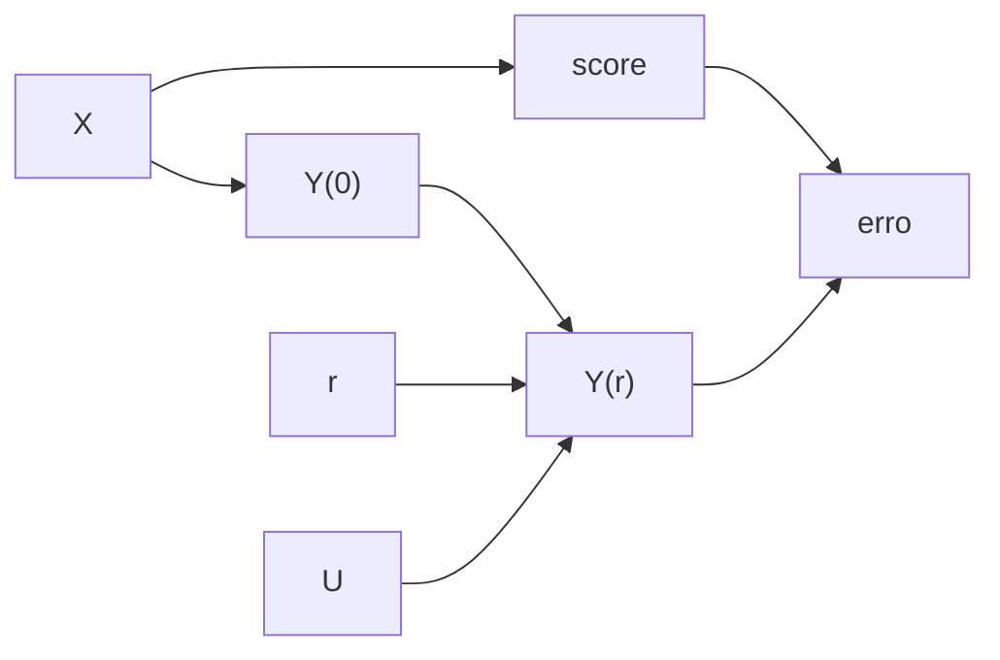

# Causalidade e degradação supervisionada no simulador

## Pergunta, população e hipóteses

Qual é o efeito de um choque externo hipotético r na taxa de inadimplência e no
erro probabilístico de um modelo congelado, dentro deste simulador?
A população avaliada são as seis janelas disjuntas de 1.000 registros do pool de
produção reservado. O tempo é um índice simulado, sem data histórica atribuída.
As variantes de cada janela compartilham registros e devem ser comparadas por pares.

O diagrama explicita hipóteses do simulador, sem representar descoberta causal na
base de crédito:

O modelo permanece congelado. X não recebe r, U, ID, rótulos ou demografia.
U é produzido com um Generator NumPy exclusivo, seed 42, uma realização por ID
ordenado no conjunto das janelas; a associação fica em `latent.parquet` local.
O gerador não consulta features, scores ou labels. A independência é uma hipótese
imposta pela construção pseudoaleatória, sem teste ou alegação sobre choques reais.

## Intervenção e estimandos

`Y(r) = Y(0) OR ((Y(0)==0) AND (U<r))`, com `r_j=0,35*j/(J-1)`.
`Y(0)` é o alvo observado e permanece em arquivo separado. `Y(r)` é identificado
como `synthetic_external_shock`. Positivos originais não são revertidos; negativos
podem virar positivos. Com r=0, os labels são exatamente iguais ao controle.

Sob o mecanismo imposto,
`P_r(Y=1|X)=P_0(Y=1|X)+(1-P_0(Y=1|X))*r`.
P(X) e scores permanecem iguais. P(Y) também pode mudar: concept drift e mudança
de prevalência não são classificações mutuamente exclusivas.

Estimandos por janela, condicionais ao modelo e aos registros reservados:

- Aumento médio de default: `mean(Y(r)-Y(0))`.
- Expectativa sobre novas realizações de U: `r*mean(Y(0)==0)`.
- Efeito no erro: `mean((Y(r)-score)^2-(Y(0)-score)^2)`.

O erro padrão Monte Carlo da primeira média é
`sqrt(n_neg*r*(1-r))/n`, condicionado aos labels originais. O intervalo normal
`expectativa +/- 1,96*erro_padrao` é uma aproximação da variação entre choques,
sem interpretação como intervalo para efeito econômico populacional.
O bootstrap percentil pareado usa 1.000 reamostragens de IDs com reposição e
Generator separado de seed 42. Cada índice seleciona conjuntamente os dois labels
e o score fixo. Seus ICs de 95% descrevem a variabilidade dos pares realizados,
condicional ao modelo e ao choque sorteado; não incluem incerteza de treino,
seleção de features ou validade externa. São duas fontes de incerteza distintas.

## Separação de cenários e chegada dos labels

`stable` preserva as janelas e labels observados. `invalid` usa somente a primeira
janela, com nulo em `limit_bal`, ID duplicado e `pay_amt1` negativo em linhas
distintas. O contrato bloqueia o lote inteiro antes de carregar o preditor;
nenhum arquivo de scores ou métrica supervisionada é gerado para essa variante.

`data_drift` transforma exclusivamente `pay_0` e `limit_bal`, selecionadas pela
permutação na validação, com `a_j=j/(J-1)`. Usa `min(8,x+round(3*a_j))` e
`x*(1+2*a_j)`, respectivamente. Campos inteiros usam arredondamento para o inteiro
mais próximo, com empate par. As outras 17 features ficam idênticas.
Para outras features financeiras suportadas, a regra versionada é
`x+2*a_j*max(IQR_treino,1)`. O IQR vem exclusivamente do treino.
Esse cenário é perturbação de entradas, sem alegação de covariate shift puro ou
realismo econômico conjunto. Seus labels ficam indisponíveis e não são copiados:
a performance é `null`, com status `labels_unavailable`.

A predição ocorre antes da leitura/associação de labels. O manifesto registra
`pre_label_status: labels_unavailable`; a chegada posterior é uma associação
explícita por ID, sem espera de relógio. IDs faltantes, extras, duplicados ou alvos
inválidos falham. Igualdade de features e scores do par é verificada antes da
comparação. O avaliador confere hashes, associação de U e reconstrução de Y(r).

## Resultados medidos

Execução em Docker em 24/10/2026, sem alteração de seed, intensidades ou critério.
Cada linha tem 1.000 registros. Evidência completa, incluindo AUC, AP, recall,
log loss, precisão, F1 e matrizes, em [scenarios.json](evidencias/scenarios.json).

| Janela | r | Brier original | Brier sintético | Diferença | IC95% pareado | Default adicional | Esperado |
|---|---|---|---|---|---|---|---|
| 0 | 0.00 | 0.133505 | 0.133505 | 0.000000 | [0.000000; 0.000000] | 0.00000 | 0.00000 |
| 1 | 0.07 | 0.123974 | 0.160326 | 0.036352 | [0.026630; 0.047000] | 0.05700 | 0.05474 |
| 2 | 0.14 | 0.142457 | 0.215305 | 0.072848 | [0.059157; 0.087272] | 0.10800 | 0.10766 |
| 3 | 0.21 | 0.127475 | 0.238209 | 0.110734 | [0.092696; 0.128974] | 0.17400 | 0.16611 |
| 4 | 0.28 | 0.142450 | 0.278551 | 0.136101 | [0.116818; 0.155789] | 0.21300 | 0.21476 |
| 5 | 0.35 | 0.137436 | 0.315224 | 0.177789 | [0.157599; 0.199006] | 0.27200 | 0.27055 |

Na última janela, o critério foi aprovado: diferença de Brier >0,02 e limite
inferior do IC95% >0. Recall mudou de 0,339207 para 0,186373; ROC-AUC de 0,774800
para 0,615952. AP aumentou de 0,560260 para 0,651553, e precisão de 0,669565 para
0,808696. Essas melhoras também são registradas, pois a prevalência aumentou
de 0,227 para 0,499; nem toda métrica precisa piorar com o choque.

Default adicional observado de 0,272, esperado 0,27055, erro padrão Monte Carlo
0,013261 e faixa normal aproximada [0,244558; 0,296542]. O IC bootstrap pareado
do default adicional foi [0,244; 0,301]. A primeira janela, r=0, teve efeito zero
e intervalos degenerados em zero. Não houve busca por seed favorável.

## Identidade, reprodução e limites

- Modelo: `3a1a313f639fbbf23388c90a0227bc9d29936aec574d27ca471cf52de7ed293c`.
- Geração: `06cb9e92167256554fea8d542426df152e99e623f9edcb495d41b53523c0808e`.
- Configuração: `47012b7f13499f8930e3ece1bc1de763f6ba44ba816c1a4245214890823d48da`.

Execute o percurso do README até a promoção, depois `make docker-simulate` e
`make docker-evaluate-scenarios`. O primeiro comando gera uma versão completa em
`data/scenarios/versions/<hash>/` e troca `data/scenarios/current` atomicamente.
O manifesto contém hashes de origem, split, modelo, arquivos, transformações,
intensidades, janelas e origem dos labels. A repetição preserva bytes e versão.
Falha não substitui a versão anterior. O segundo verifica a geração e publica
agregados locais e em `docs/evidencias/scenarios.json`; saída 2 indica critério de
degradação reprovado, saída 1 indica erro operacional. Hashes detectam corrupção,
sem autenticar artefatos recebidos de terceiros.

A comparação identifica o efeito da intervenção implementada neste simulador.
Não identifica efeitos reais de inflação, desemprego ou alteração do limite.
O choque homogêneo e irreversível não representa necessariamente comportamento
financeiro real. A base histórica de Taiwan não valida desempenho no Brasil.
A recomendação é investigar coleta, obter labels e revisar o modelo; não inferir
política econômica de crédito a partir dessas associações.

IDs, U, scores, dados individuais e labels ficam locais e ignorados pelo Git.
A exclusão de demografia e o uso de hashes não garantem anonimato ou equidade.
Detecção estatística de drift e alertas operacionais não integram esta medição
supervisionada. O critério pareado não equivale ao alerta contra a validação.

## Interpretação final

O resultado numérico quantifica a intervenção construída em `causal.py`: para
cada janela, X e score permanecem pareados e somente Y é substituído pela regra
sintética. Na última janela, r=0,35, o aumento médio do Brier foi 0,177789 e o
intervalo percentil bootstrap pareado de 95% foi [0,157599; 0,199006], com 1.000
reamostragens. O estimando é condicional aos registros da janela, ao modelo
congelado e ao mecanismo de U independente por construção. Não representa uma
amostra de intervenções econômicas nem demonstra que variáveis financeiras causem
inadimplência no mundo real.

O diagnóstico de SEX/AGE no teste também é descritivo e não causal. A importância
por permutação em validação mede a dependência do modelo em relação às features;
não prova efeito causal, adequação de uso ou justificação de política de crédito.
